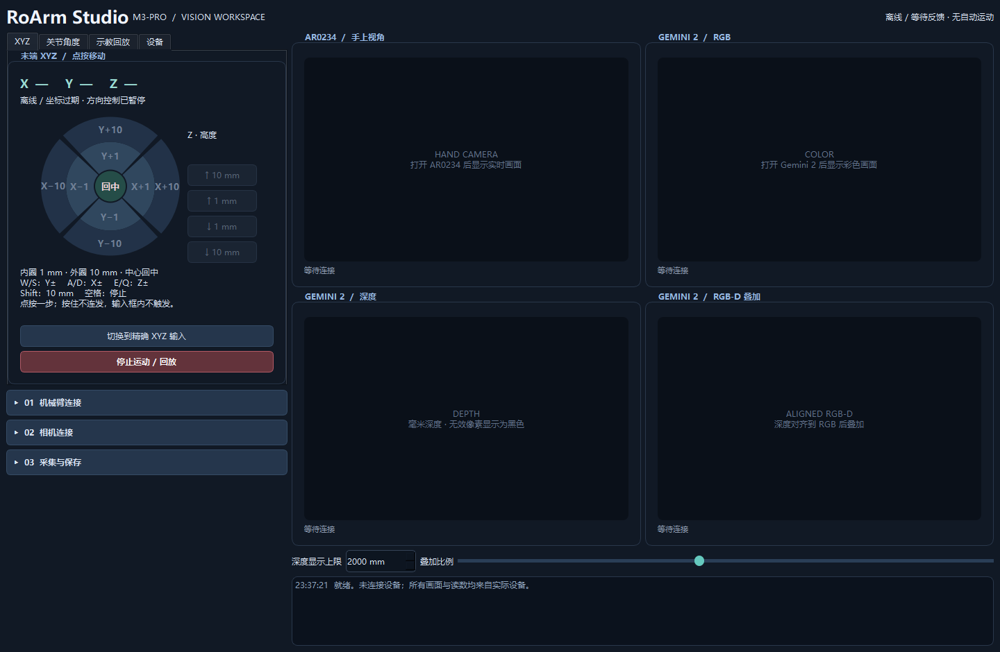

# RoArm Studio

RoArm-M3-Pro 与双相机 Windows 桌面工作台。

## 下载与安装

进入 [Releases 下载页面](https://github.com/Azucia/RoArmStudio/releases/latest)：

- **RoArmStudio-0.3.0-Setup-x64.exe**：推荐，双击安装，不需要 Python 或管理员权限。
- **RoArmStudio-0.3-Windows.zip**：免安装完整包，解压后打开 `RoArmStudio/程序/RoArmStudio/RoArmStudio.exe`，保留 `_internal` 文件夹。
- GitHub 自动生成的 **Source code** 压缩包仅含源码，不是可直接运行的软件。

系统：Windows 10 1809 或更高版本 / Windows 11，x64。



## 功能

左侧固定控制区包含四个同级页签：

- **XYZ**：方向盘内圈 1 mm、外圈 10 mm；WASD 控制 XY，E/Q 控制 Z，Shift 切换 10 mm；精确 XYZ 输入与回初始位。
- **关节角度**：六关节目标、单关节移动、全关节联动、速度与加速度。
- **示教回放**：记录实际关节轨迹，保存并自动载入，低速回放、倍率和随时停止。
- **设备**：扭矩保持、补光灯和实际反馈。

连接、相机、采集保存默认折叠。右侧显示 AR0234、Gemini RGB、深度和对齐后的 RGB-D 叠加。

## 连接

机械臂正常供电，通过 USB 串口接电脑，选择串口后连接；连接仅查询反馈，不自动运动。AR0234 需为 USB UVC 模组。Gemini 2 使用 Orbbec 官方 SDK，当前仅连接一台 Gemini 2。

XYZ 逆运动学由机械臂固件执行。方向盘点按或键盘按下一次移动一步，不连续长按发送。软件停止依赖串口与实际反馈，不是硬件急停。手动示教释放扭矩前请托住机械臂。

相机采集保存 JPEG、16 位深度 PNG 和带时间戳的关节反馈，最多约 10 Hz。各源采用独立主机接收时间，未提供硬件同步或手眼标定。

## 当前验证范围

v0.3.0 完成 12 项离线检查及打包 EXE 启动检查。开发时未连接 M3-Pro、AR0234 与 Gemini 2；真实运动、相机兼容性、D2C 质量，以及网页控制时出现的肩部下垂问题尚未实机验证。

安装包没有代码签名。软件不会自动改写机械臂或相机固件。

## 源码构建

Python 3.11 x64：

```powershell
python -m venv .venv
.venv\Scripts\python -m pip install -r source\requirements.txt
.venv\Scripts\python source\launcher.py
.venv\Scripts\python -m unittest discover -s source -p "test_*.py" -v
.venv\Scripts\python source\build.py
```

`source/installer.iss` 用于 Inno Setup 打包安装版；通过 `SourceRoot` 指向包含程序、使用说明与 licenses 的完整产物目录，通过 `ReleaseOutput` 指定安装包输出目录。

第三方组件许可证位于 `licenses`。详细操作见 [使用说明](使用说明.md)。
